<p align="center">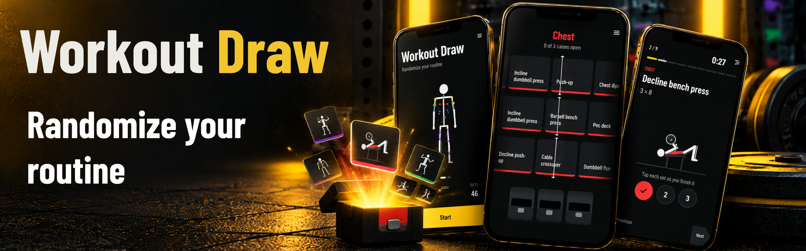</p>

<p align="center"><b>Randomize your routine.</b><br>
Don't know what to train today? Spin for it. Every exercise is revealed like a case opening,<br>
then becomes a clean plan you can follow set by set.</p>

<p align="center"><a href="https://workoutdraw.netlify.app"><b>▶ Try it live: workoutdraw.netlify.app</b></a><br>
<sub>Best on a phone, or a phone-sized browser window.</sub></p>

<p align="center">
  
  
  
  
  
  
</p>

<p align="center">
  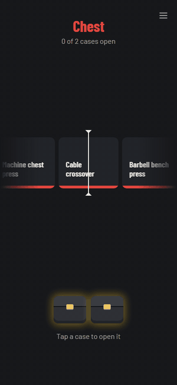
  &nbsp;&nbsp;
  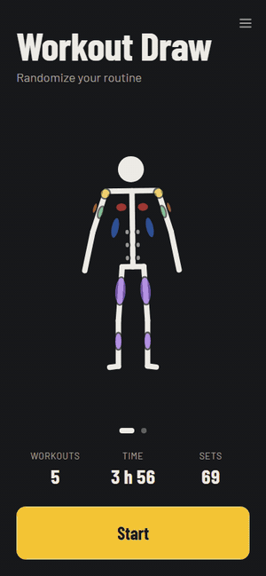
</p>

---

## What it is

Workout Draw is a phone-sized web app for the moment you walk into the gym (or your living room) with no plan. Tell it how much time you have, what you want to hit and where you are. Then the fun part: **every slot of your workout is a roll**. A slot machine decides how many exercises each muscle group gets, and each exercise is unboxed from its own case. You end up with a real plan with sets and reps, can follow it set by set, and watch your stickman bulk up over time.

It runs entirely in the browser. No account, no server: your history stays on your device.

## How a draw works

| 1 · Time | 2 · Muscles | 3 · Gym or home | 4 · Count roll |
|:-:|:-:|:-:|:-:|
| 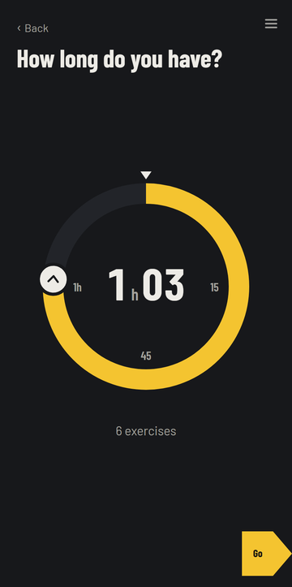 | 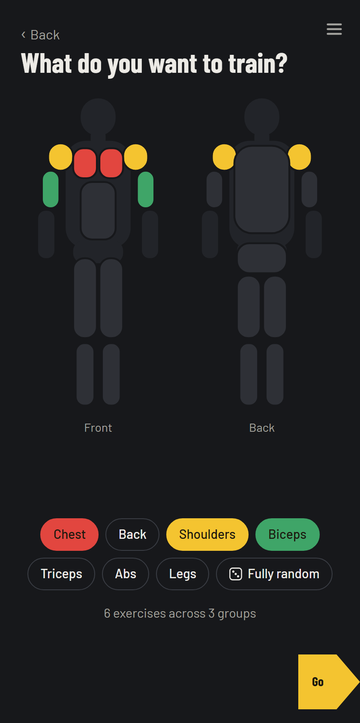 | 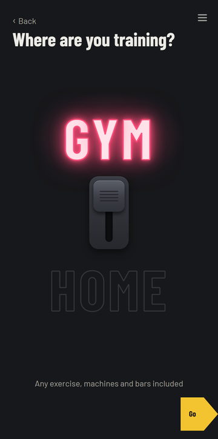 | 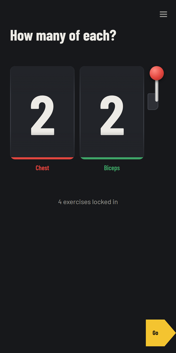 |
| Spin the dial. The time sets how many exercises you get. | Tap groups on a front/back body map, or go fully random. | Flip the neon switch. Home means bodyweight only. | Pull the lever: one reel per group decides the split. |

| 5 · Open the cases | 6 · Your plan | 7 · How to do it | 8 · Train |
|:-:|:-:|:-:|:-:|
| 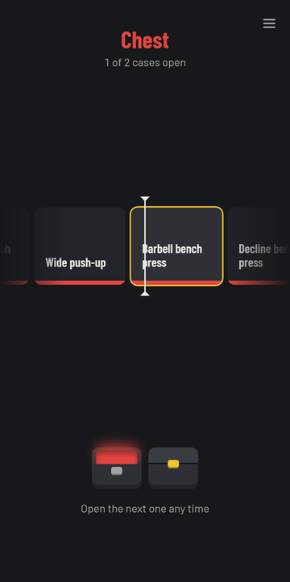 | 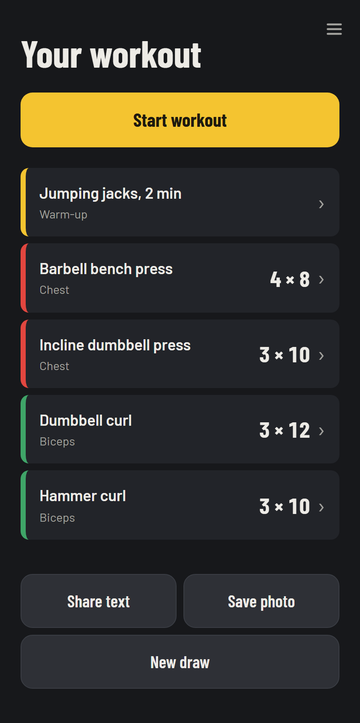 | 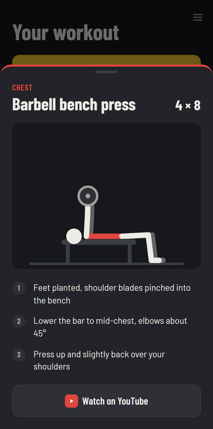 | 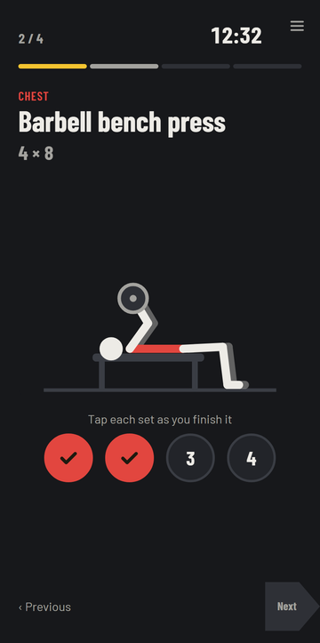 |
| Tap a case: the strip spins and lands on an exercise. | Warm-up plus every exercise with sets × reps. Share it as text or a photo. | Animated figure, three form cues, and a YouTube search. | One exercise at a time: tick each set, timer running. |

## Features

- **Case-opening reveals.** Results are decided before the animation plays; the strip is built around the real result, eases to a stop under the marker, ticks as items pass and chimes when it lands.
- **Setup that feels physical.** Drag-to-set time wheel with a ratchet click, tappable body map, a flickering neon gym/home switch, a pullable slot-machine lever.
- **83 animated how-to figures.** Every exercise and warm-up has a looping stick-figure animation: side view for most moves, front or back view where it reads better (lateral raises, presses, pull-ups). Planted feet and hands stay put thanks to a small two-bone solver.
- **Workout mode.** Step through the plan, tick sets, and finish with a summary. Reloading mid-workout picks up where you left off, timer included.
- **A stickman that grows with you.** Muscle groups on the Start screen grow with the sets you finish. He idles, breaks into one of 3 dances or 5 bodybuilding poses when tapped, and after a workout he poses for each group you trained while it grows.
- **Balance chart.** A 7-sided radar of your training per muscle group, with "+sets" badges for your latest workout.
- **History and library.** Every finished workout, expandable to the sets you did, plus a browsable library of all exercises with their animations.
- **Share.** Send the plan as text, or as a generated image card that matches the app.

<p align="center">
  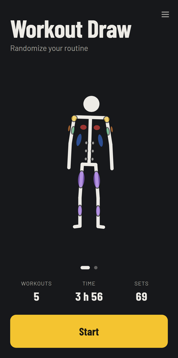
  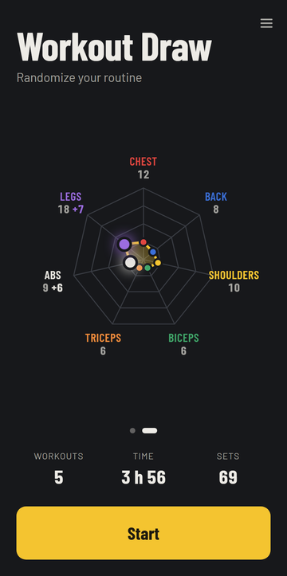
  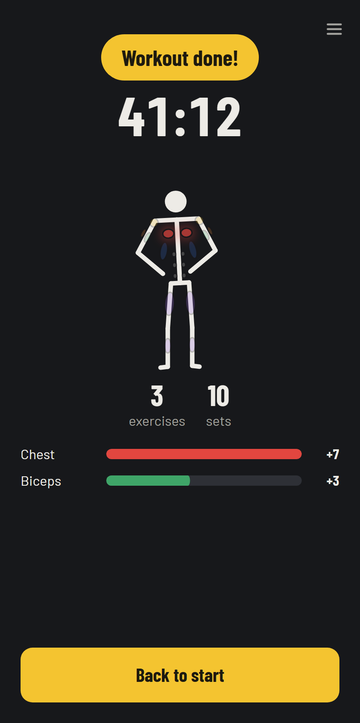
  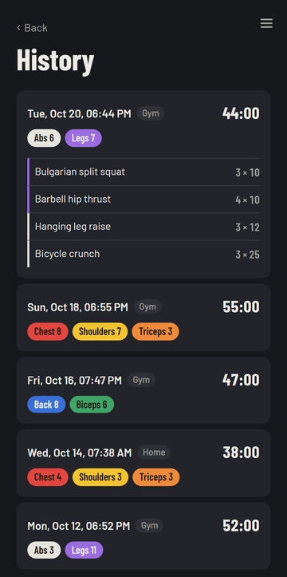
</p>

## Run it locally

You need [Node.js](https://nodejs.org/) 20.19+ or 22.12+.

```bash
git clone https://github.com/RocoCroco/build-with-ai-hack-oct-2026.git
cd build-with-ai-hack-oct-2026
npm install
npm run dev        # open the URL it prints; a phone-sized window works best
```

To try it on your phone, run `npm run dev -- --host` and open the "Network" URL on a phone on the same Wi-Fi.

| Command | What it does |
|---|---|
| `npm run dev` | Start the dev server |
| `npm test` | Run the 132 unit tests (draw logic, reducer, figures, stickman, stats) |
| `npm run build` | Type-check and build to `dist/` |
| `npm run lint` | Lint with oxlint |

## Under the hood

- **React 19 + TypeScript + Vite**, animations with **Motion**, sounds generated with the Web Audio API (no audio files), no UI library.
- **One reducer drives the whole journey** (`src/lib/drawState.ts`), from Start through the rolls to the done screen. The session is saved as you go, so a reload resumes.
- **Draw logic is pure and tested** (`src/lib/draw.ts`): exercise count from time, per-group split, no repeats, sets and reps within each exercise's range, gym/home filtering.
- **Figures are data, not drawings.** Each exercise is a few keyframes of joint angles and hand/foot targets (`src/data/figures.ts`), played by a tiny engine (`src/lib/figure.ts`). Tests check that every figure stays in frame and planted limbs don't slide.
- **Storage sits behind one interface** (`src/lib/storage.ts`). Today it's `localStorage`; moving history online is a matter of writing another implementation.

```
src/
  App.tsx            screen switching and the corner menu
  screens/           one component per step, plus the stickman, chart and figures
  lib/               draw logic, reducer, storage, workout, stats, animation engines
  data/              exercises, form cues, figure poses
  styles/base.css    colors (one plate color per muscle group), fonts, shared buttons
```

## Built with AI

This was built for the **Build With AI: Basics** hackathon with Claude Code, planning first and then building in small, verified slices. The planning and build records are in [`devpost/`](devpost/): the [scope](devpost/scope.md), [product requirements](devpost/prd.md), [technical spec](devpost/spec.md), the [build checklist](devpost/checklist.md) with every revision, and an [app map](devpost/app-map.html) for finding your way around the code.

The project also includes a custom Claude Code skill, [`animation-check`](.claude/skills/animation-check/SKILL.md): when an animation is reported broken, it proves the fix by sampling it in a real browser over real time instead of trusting still screenshots.

## What's next

- Optional online sync (e.g. Supabase) behind the existing storage interface
- Home workouts with equipment (dumbbells, a bench)
- A "gamble" upgrade: risk a result for a chance at a different exercise

## License

Copyright (C) 2026 Roc Cutal

Workout Draw is free software: you can redistribute it and/or modify it under the terms of the [GNU Affero General Public License](LICENSE) as published by the Free Software Foundation, either version 3 of the License, or (at your option) any later version.
